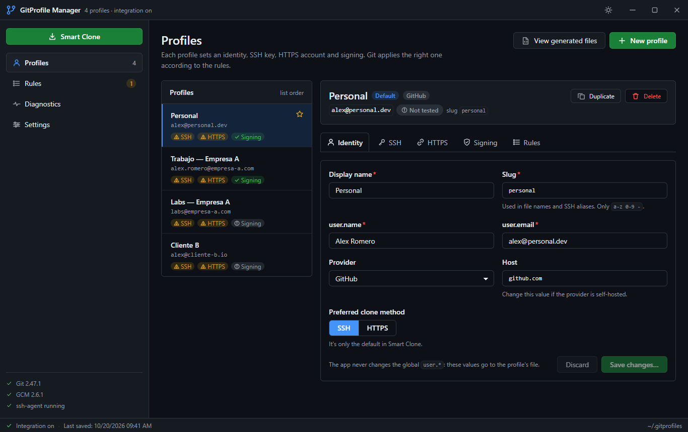
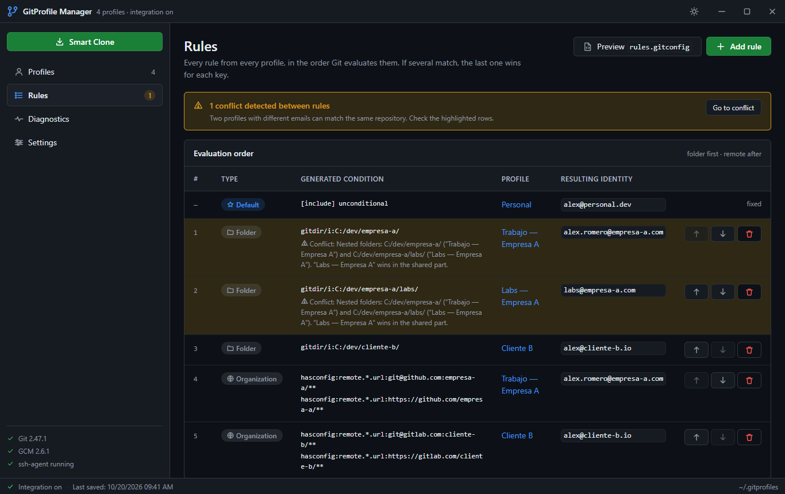
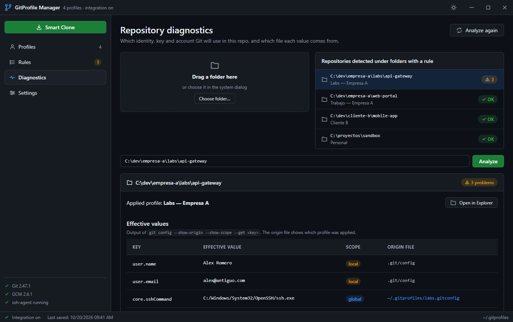
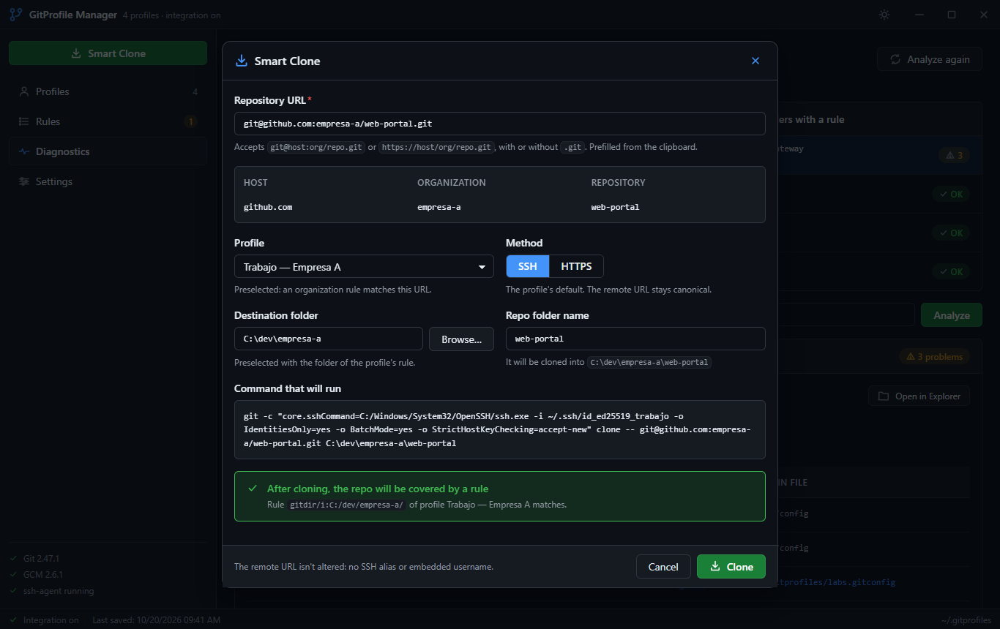
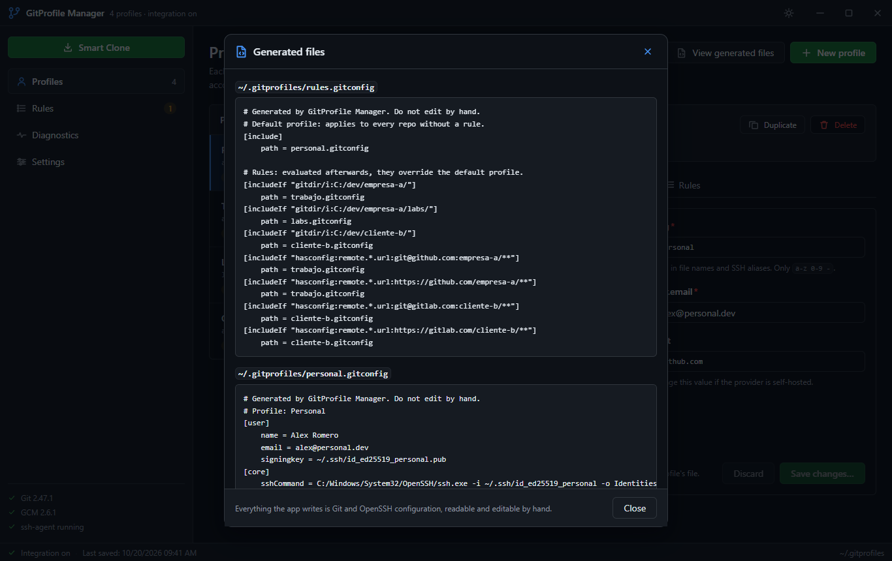
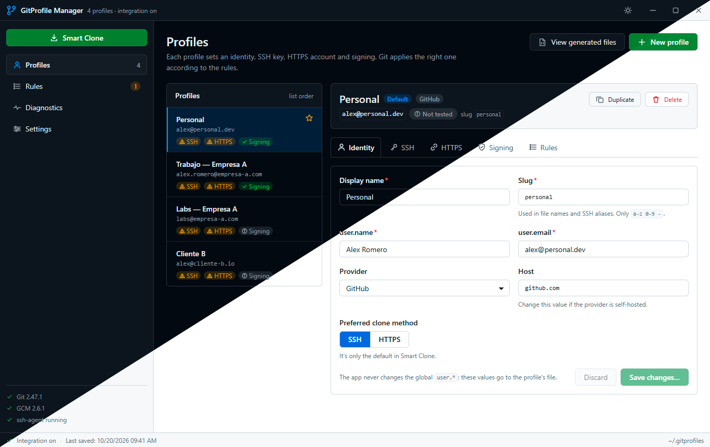

<div align="center">


# GitProfile Manager

**The right Git identity in every repository, without thinking about it.**
Set up your personal, work and client accounts once, and Git picks the right name, email, SSH key,
HTTPS account and signature for each repo on its own.

[](https://github.com/sergiosahuquillo/git-profile-manager/releases/latest)
[](https://github.com/sergiosahuquillo/git-profile-manager/releases)
[](https://github.com/sergiosahuquillo/git-profile-manager/actions/workflows/build.yml)
[](../LICENSE)


[](https://github.com/sergiosahuquillo/git-profile-manager/releases/latest)
[](https://sergiosahuquillo.github.io/git-profile-manager/)



</div>

## Why GitProfile Manager

- **No more commits with the wrong email.** Tell the app which folders and which organizations belong
  to each account, and Git applies the right one in every repo: on the command line, in your editor and
  in SourceTree alike.
- **Nothing runs in the background.** The app writes plain Git and OpenSSH configuration and gets out
  of the way. You can close it, or even uninstall it, and your repos keep working.
- **You see every change before it happens.** Each save shows the exact diff or command first, and
  nothing is written until you confirm. Your own files get a dated backup before they're touched.
- **No passwords in the app.** HTTPS sign-ins go through Git Credential Manager, which keeps them in
  Windows Credential Manager, as Git already does.
- **Free and open source**, under the GPL-3.0.

## Features

### One profile per account

Each profile holds a name and email, an SSH key, an HTTPS account and how commits are signed. Works with
GitHub, GitLab, Bitbucket, Azure DevOps and self-hosted servers.

- **SSH keys made easy**: create a new key (with passphrase if you like), add it to the agent, copy the
  public key and test the connection, all from the profile.
- **Signed commits** with your SSH key or with GPG, so you get the *Verified* badge.
- **HTTPS accounts**: see which accounts Git Credential Manager has saved, and sign in again when a
  token expires.

### Rules that decide for you

A rule says *"repos in this folder"* or *"repos from this organization"* use this profile. Everything
else uses your default profile. The app warns you when two rules could clash, and tells you which one
wins.



### Diagnostics: why is Git using that email?

Point it at any repo and it shows which profile applies, the value Git will actually use for each
setting and the file it comes from. It spots the usual problems, such as an old email fixed in the
repo itself, a key with the wrong permissions or an expired HTTPS sign-in, and fixes them for you.



### Smart Clone

Paste a repository URL and the app picks the profile, the method (SSH or HTTPS) and the folder, shows
you the exact command, and tells you whether a rule will cover the new repo.



### No magic, just Git configuration

Everything the app writes is standard Git and OpenSSH configuration that you can read, and edit by
hand if you want. In your own `.gitconfig` and `~/.ssh/config` it adds a single line each.



### And also

- A first-run wizard that checks Git, Git Credential Manager and the SSH agent, and can turn your
  current global identity into your default profile.
- Backups of every change, restorable in one click.
- Plays well with SourceTree.
- Dark and light modes, in English and Spanish.



## Install

1. Download `GitProfileManager-<version>-setup.exe` from the
   [latest release](https://github.com/sergiosahuquillo/git-profile-manager/releases/latest).
2. Run it. It installs for your user only, no administrator rights needed. The installer isn't
   code-signed yet, so Windows SmartScreen may say *"Windows protected your PC"*: click **More info** →
   **Run anyway**.
3. Open GitProfile Manager and follow the wizard.

**Requirements:** Windows 10 (22H2) or Windows 11, with
[Git for Windows](https://git-scm.com/download/win) 2.36 or later, which includes Git Credential
Manager.

To update, run the new installer over the old one: your profiles and settings stay.

## FAQ

<details>
<summary><b>Does it change my global Git configuration?</b></summary>

Barely. It adds one include line to your `.gitconfig` and one to `~/.ssh/config`, after a backup.
Everything else lives in its own files (`~/.gitprofiles` and `~/.ssh/gitprofile.conf`). Your global name
and email are only touched if you choose to in the first-run wizard, and they're saved first.
</details>

<details>
<summary><b>Does the app need to stay open?</b></summary>

No. Git reads the configuration the app wrote, so the app is only for setting things up. It doesn't
start with Windows.
</details>

<details>
<summary><b>Will it delete or change my SSH keys?</b></summary>

Never. It can create new keys and fix the permissions of an existing one if you ask it to, but it never
deletes keys, not even when you remove the app.
</details>

<details>
<summary><b>How do I uninstall it cleanly?</b></summary>

First go to **Settings → Remove the app**: it turns the integration off and deletes the files it
generated, keeping your SSH keys. Then uninstall it from *Installed apps* in Windows. If you skip the
first step, Git keeps using your profiles as they were, which may be exactly what you want.
</details>

<details>
<summary><b>Does it work on macOS or Linux?</b></summary>

No, it's Windows-only: it relies on the Windows SSH agent, Windows Credential Manager and Windows file
permissions.
</details>

## Build from source

You need Rust (MSVC), Node 20+ and pnpm on Windows:

```bash
pnpm install
pnpm tauri dev
```

The developer documentation, covering the architecture, tests and how releases are made, is in the
[main README](../README.md).

## Credits

- [Tauri](https://tauri.app/), [React](https://react.dev/) and [i18next](https://www.i18next.com/): the
  window, the interface and the translations.
- [Git Credential Manager](https://github.com/git-ecosystem/git-credential-manager): the HTTPS sign-ins.

## License

GitProfile Manager is free software under the [GNU General Public License v3.0](../LICENSE).

## Star history

<a href="https://www.star-history.com/#sergiosahuquillo/git-profile-manager&Date">
  <picture>
    <source media="(prefers-color-scheme: dark)" srcset="https://api.star-history.com/svg?repos=sergiosahuquillo/git-profile-manager&type=Date&theme=dark" />
    <source media="(prefers-color-scheme: light)" srcset="https://api.star-history.com/svg?repos=sergiosahuquillo/git-profile-manager&type=Date" />
    
  </picture>
</a>
